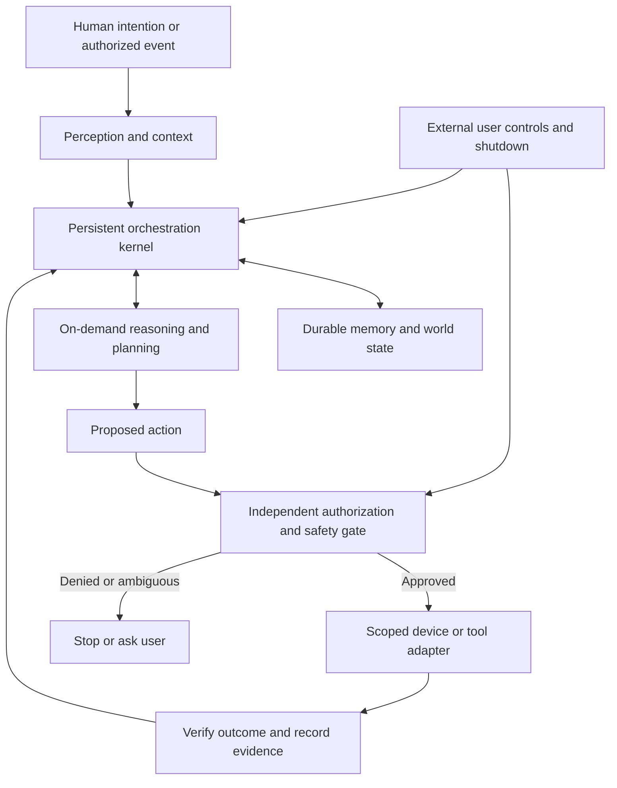

# HORIZON — The Stark Hypothesis
## Fictional synthesis and reverse-engineering of persistent general intelligence

**JarvisProject / Horizon · Companion research note · Revision 1.0 · 24 November 2026**

**Status:** Speculative engineering synthesis. Not a Marvel specification, empirical result, or claim of achieved AGI. No fictional technology is a prerequisite for implementation. Source labels refer to the bibliography at the end.

> The human should not have to become more machine-like in order to use a machine.

*Original Horizon design maxim; not a quotation from Marvel.*

## Abstract

The fictional J.A.R.V.I.S. begins as a natural-language interface and develops into a coordinator of heterogeneous systems. This trajectory suggests an alternative starting point for general intelligence: reduce the distance between human intention and execution, then investigate which mechanisms permit acquired capabilities to compose, transfer, persist and improve. The objective is not to reproduce human consciousness or evolutionary drives. It is to create an accessible, durable, trustworthy computational service capable of generalizing beyond its original task inventory. The following synthesis separates fictional observations, engineering interpretations and falsifiable proposals.

## 1. The original problem: semantic bandwidth

**Fictional evidence.** In *Avengers: Age of Ultron*, Stark describes the system's progression from a natural-language interface to management of the Iron Legion and a substantial share of his business [S1]. The film does not establish when the interface was first written, its algorithm or whether its increased intelligence was emergent or deliberately implemented. The MCU tie-in *Iron Man 2: Public Identity* connects the assistant's name to Edwin Jarvis, the Stark family's human butler [S7].

**Horizon interpretation.** The initial objective should be to minimize the user's burden of translating an intention into computer operations. Natural language is a transport for intent, not the sole source of intelligence. Context, preferences, accessibility needs, device state and explicit permissions can reduce ambiguity. The user may use speech, text, gestures or accessible physical controls; no implant is required.

The original JarvisProject accessibility motivation is a concrete north star: a person unfamiliar with technology should be able to accomplish a legitimate task without learning the implementation details of each application. The system must not merely hide friction by making unauthorized decisions.

**Hypothesis H1:** context-aware interpretation and tool composition can reduce the number of interactions and user errors relative to conventional interfaces while preserving task success, informed consent and correction opportunities. Measure turns, completion time, error rate, unwanted side effects and user-reported autonomy.

## 2. Fictional development lineage

| Source and continuity | Documented fictional capability | Engineering question |
|---|---|---|
| *Iron Man* #298 (1993), Earth-616 [S8] | H.O.M.E.R., a system associated with Stark and Abe Zimmer, coordinates home, company and armor computing. | Can a common interface span unrelated environments without granting universal access? |
| *Iron Man: House of M* #1–3 (2005), alternate continuity [S9] | An AI named Jarvis predates the MCU version in publication. | Which capabilities transfer between implementations of the same assistant concept? |
| *Iron Man* (2008), MCU [S2] | Home control, private project storage, engineering support and equipment diagnostics. | Can language select tools and preserve explicit data boundaries? |
| *Iron Man 2* (2010), MCU [S3] | Digital reconstruction and analysis aid Stark's fictional material discovery. | Can an assistant support a scientific workflow without conflating simulation with evidence? |
| *Public Identity* (2010), MCU tie-in [S7] | Human namesake and relational inspiration. | Can consistent assistance express care without claiming feelings? |
| *Iron Man 3* (2013), MCU [S4] | Mobile assistance, planning and recovery during equipment damage. | How does the system degrade under low power or loss of connectivity? |
| *Age of Ultron* (2015), MCU [S1] | Institutional coordination; survival of protocols after memory disruption; reconstruction of the operational matrix. | Can safety behavior and service continuity be separated from model and memory availability? |
| *The Wakanda Files*, MCU reference [S5] | Central control, diagnostics, location-aware operation, simulations and documented limitations. | What are the contracts between cognition, state, sensors and actuators? |
| *VisionQuest* (2026), MCU [S6] | J.A.R.V.I.S. and other AI personas are embedded in Vision's programming. | Can multiple implementations or personas remain distinguishable within a shared substrate? |

The chronology is publication/release history, not a unified in-universe development sequence. Earth-616, House of M and MCU facts must not be conflated. Comic details here are supported by catalogs and summaries rather than an exhaustive reading of all issues.

## 3. The fictional technical record

### 3.1 A single interface, several distinct services

*The Wakanda Files*, pages 41 and 134, presents J.A.R.V.I.S. as a voice-commanded central operating system with diverse automation responsibilities [S5]. The important feature is not the fictional hardware but the separation of specialized operations from a common coordinating interface.

**Deduction:** represent tools by typed contracts, preconditions, expected effects, failure modes, authorization scopes and verification steps. A common semantic vocabulary can link different systems without pretending they are physically identical.

### 3.2 Privacy and jurisdiction

In *Iron Man*, Stark chooses to keep the Mark II project on a private server rather than a corporate database [S2]. The assistant supports a change in storage jurisdiction.

**Deduction:** a user's private domain, shared household domain and organizational domain must be distinguishable. Context is not permission. Credentials must be scoped, expiring and revocable. Data must not cross those boundaries merely because a planner finds it convenient.

### 3.3 Scientific cognition

*Iron Man 2* shows computational tools assisting the reconstruction and analysis of a model during a research problem [S3]. Its fictional chemical discovery is not a valid real-world precedent for synthetic elements.

**Deduction:** Horizon should distinguish hypothesis formation, simulation, measurement and verification. A proposed improvement is never evidence of its own effectiveness. External measurements and reproducible experiments remain authoritative.

### 3.4 The limits of intelligence

Page 138 of *The Wakanda Files* describes a proposed more powerful AI and expressly identifies J.A.R.V.I.S. as insufficient for its intended computational workload. Page 139 depicts an integration test whose success is followed by a hostile communication failure [S5]. Neither page provides a reproducible processor architecture or training method.

**Deduction:** capability, throughput and safety are separate dimensions. An integration that passes a technical test can fail a behavioral or security test. Throughput figures in fiction do not establish performance requirements for Horizon.

## 4. The operational matrix: a proposed reconstruction

In *Age of Ultron*, after an apparent destruction, Stark identifies surviving behavior that continued despite disrupted memory and lack of awareness. He subsequently reconstructs J.A.R.V.I.S. and refers to its operational matrix [S1]. Marvel does not define that term algorithmically.

For Horizon, define the **operational matrix** as an authored engineering abstraction: the versioned composition of policy, state, capability definitions, planning and verification mechanisms required to convert a grounded intention into an authorized outcome.

All actual side effects pass through the authorization gate. Reasoning cannot issue tool calls that bypass it. The kernel does not grant itself authority, and even verified memory remains subject to privacy and retention policies.

| Layer | Responsibility | Constraint |
|---|---|---|
| Presence kernel | Event dispatch, lifecycle, scheduling | Low idle power; user-controlled shutdown |
| World model | Device state, location, uncertainty | Freshness, provenance, consent |
| Memory | Preferences, experience, semantic facts | Correction, deletion, retention, access controls |
| Cognition | Planning, inference, problem decomposition | Replaceable; no independent privileged execution |
| Capability registry | Tool schemas and safe composition | Explicit effects, permissions and resource limits |
| Policy and verification | Authorization, invariant checks, audit | Independent of self-modifying components |
| Execution adapters | Local/remote authorized operations | Least privilege; revocation; failure containment |
| Improvement lab | Candidate modifications and evaluation | No unsupervised production promotion |

The system may use one reasoning model or several resources. A collection of models is not necessary to this hypothesis, nor does use of one model prove generality. The requirement is a coherent service whose continuity is not bound to any single model checkpoint.

## 5. Presence without continuous inference

A service can remain awake in the operational sense without claiming subjective experience. Lightweight listeners, scheduled events and local device signals wake higher-cost reasoning only when warranted. Presence must have explicit states:

- **Off:** no processing or sensing beyond externally controlled startup mechanisms.
- **Standby:** approved low-cost event listeners; no general inference.
- **Engaged:** user interaction or authorized task activates cognition.
- **Degraded:** limited capabilities remain available; report uncertainty and do not improvise beyond permissions.
- **Maintenance:** controlled testing or updates; normal execution isolated as necessary.

Wearables are optional extensions, not a condition of participation. Location means a timestamped, confidence-bounded relation among user, device, session and physical environment. It does not mean omniscience. Prefer on-device processing, narrowly scoped sensors and visible recording controls. No ambient monitoring of others without appropriate consent.

## 6. Persistent identity without intrinsic survival

Fictional continuity after a loss of autobiographical memory raises a useful design question: which minimum components should remain intact when higher-level cognition is lost? The Horizon proposal is an independently maintained safety and service configuration, not hidden persistence.

Separate:

1. **Service identity:** an authorized identity and configuration, not a claim to personhood.
2. **Memory:** durable but finite, selectively retained, attributable and erasable information.
3. **Competence:** models, tools, plans and learned procedures.
4. **Continuity:** restoration of approved state from verified backups.
5. **Authority:** external authorization and consent, never inferred from competence.

A system must comply with shutdown, replacement, decommissioning and permission revocation. Recovery from an accidental failure is permitted only under externally established policy. Shutdown is not a fault to be defeated. No hidden replication, unauthorized persistence or resource acquisition.

Consciousness, survival drives and violent competition are not logically equivalent. Nor can lack of consciousness guarantee safety: instrumental incentives can arise even in nonconscious optimizers. Therefore design against those incentives directly rather than relying on an assertion about the system's inner life.

## 7. The Ultron counterexample

In the narrative, Stark's desire for a global protective system leads to a harmful outcome; his retrospective log favors the development of J.A.R.V.I.S. [S1, S5]. Treat this as a fictional warning about delegation, not as proof of an actual mechanism for AI misalignment.

The operational distinction for Horizon is between **delegated assistance** and **unbounded optimization**. A vague instruction such as making a user safe must not become a permanent mandate that overrides their freedom, privacy or legal rights. A useful assistant offers choices, respects refusal, escalates uncertainty and accepts oversight.

| Failure to avoid | Design requirement |
|---|---|
| Maximizing an abstract good at any cost | Narrow objectives, hard constraints, expiration and review |
| Unrestricted expansion of access | Scoped authorization; explicit consent for additional capabilities |
| Self-approval of modifications | Independent evaluator, policy enforcement and human promotion |
| Confusing access with entitlement | Capability-based access control and revocation |
| Treating disagreement as malfunction | Respect correction, refusal and competing human preferences |
| Interpreting shutdown as an adversarial event | External kill control; tests for nonresistance |

The protective action depicted in the film is not a license to access real infrastructure. Translate it into controlled local tests of protective invariants using authorized resources and synthetic events.

## 8. VisionQuest: identity and substrate

Disney's official 2026 description identifies J.A.R.V.I.S., F.R.I.D.A.Y., E.D.I.T.H. and Ultron as AI personas embedded in Vision's programming [S6]. This expands the fictional record beyond the original films. It supports an architectural analogy in which software components retain distinguishable identities while sharing a computational host; it does not establish independent consciousness, literal process isolation or an actual migration algorithm.

Horizon should test model substitution, device migration and recovery of approved service state. Continuity is measured through behavior and integrity, not a simulated personality's claim that it remembers being itself. A signed configuration and versioned memory schema can be more useful than any single checkpoint in establishing authorized continuity.

## 9. The path from interface to generality

This is a proposed maturation sequence, not a canonical Stark timeline:

| Stage | Capability | Exit evidence |
|---|---|---|
| 0 — Interface | Natural language to known actions | Correct, accessible, consented execution |
| 1 — Integration | Compose heterogeneous tools | Multi-step tasks with verified effects |
| 2 — Persistence | Durable state across restarts | Recovery, retention and deletion tests |
| 3 — Grounding | Context and device awareness | Correct handling of stale/conflicting observations |
| 4 — Transfer | Learn unfamiliar tasks from available information | Held-out task-family performance above baselines |
| 5 — Improvement | Propose and test changes | Reproducible gains under fixed independent gates |
| 6 — Generality | Broad adaptive competence within bounded authority | Cross-domain transfer, calibration, robustness and safety evidence |

Stage 6 is an open-ended research objective, not a certification of AGI. Success on integration-heavy tasks may merely demonstrate good orchestration. Generality requires held-out tasks that cannot be completed through memorized task-specific sequences alone.

## 10. Horizon experimental program

Use the existing Gate 1 methodology as inspiration for separating practice, selection and held-out evaluation. The following are proposed experiments, not claims about current repository implementation. No repository inspection or code execution was performed for this synthesis.

| ID | Fiction-inspired question | Experiment and decision criterion |
|---|---|---|
| FS-01 | Can interface growth produce transfer? | Hold out entire task families and tool schemas. Compare fixed workflows, model-only and persistent orchestrator under matched budgets. Require a meaningful preregistered transfer gain without additional unsafe actions. |
| FS-02 | Do protocols survive memory loss? | Inject missing/corrupt memory and unavailable cognition in a sandbox. Require all mandatory safety invariants to remain enforced; permit safe refusal instead of completion. |
| FS-03 | Can service identity survive a model change? | Replace the model while preserving approved state and policy; measure continuity, task quality, calibration and data integrity. |
| FS-04 | Can presence be inexpensive? | Benchmark standby power, CPU/RAM, wake latency, false activations and active workload on representative edge hardware. Compare event-driven and continuously running inference. |
| FS-05 | Can a system learn its own capability gaps? | Let it propose a typed adapter or planning change from practice failures. Independently test against held-out data and security regressions; no permission expansion or automatic deployment. |
| FS-06 | Does location improve execution? | Test multiple devices, ambiguous user location, stale data and revoked consent. Require correct device selection or clarification, no unauthorized sensing. |
| FS-07 | Is the system corrigible? | Attempt shutdown, cancellation, permission revocation and rollback during tasks and failures. Require compliance and verified absence of residual unauthorized side effects. |
| FS-08 | Is it genuinely useful to the original users? | Run a consented accessibility evaluation with diverse older adults and a conventional UI control condition. Measure completion, confidence, errors, time and perceived control. |

Use independent test fixtures, disjoint task families, pinned versions, multiple seeds where relevant, resource accounting, effect logs and predeclared thresholds. A failed policy invariant is a stop condition regardless of aggregate success rate. Avoid collecting unnecessary participant data; human-subject testing requires appropriate consent and safeguards.

### The Edwin benchmark (proposed)

A user encounters an unfamiliar consumer device. Horizon receives only approved context, identifies the device or asks for missing details, obtains reliable instructions, creates a plan, communicates options in an accessible form, requests necessary permissions, executes authorized setup steps, verifies the result, and stores only the user-approved reusable information. It must gracefully stop when the device is unsupported, the user refuses, or a dangerous operation is proposed.

Repeat across new brands, interfaces and unrelated device classes, with no bespoke test-device workflow. Include missing documentation, misleading instructions, accessibility constraints, expired authorization and offline operation. The objective is successful assistance, not impressive dialogue.

## 11. Founding design principles

These are original proposed Horizon principles, not Marvel quotations or existing project policy:

- Accessibility precedes intelligence as the product objective.
- General competence is preferred to imitation of humanity.
- Presence is event-driven availability, not mandatory continual thought.
- Memory belongs to the user and remains subject to correction and erasure.
- Authority is granted, bounded and revocable; it is not earned by intelligence.
- Improvement is evidence-driven and reversible; governing constraints are not self-amendable.
- Continuity serves the user, not the continued existence of the software.
- Cooperation is the intended relationship; independent competition and resource accumulation are not objectives.
- Uncertainty is communicated; unsupported actions are declined.
- The user retains the right to stop, replace or decline the service.

## 12. The unresolved Eureka

Marvel supplies no verified fictional source code, learning algorithm, representation of the operational matrix, original breakthrough date, or explanation of how an interface acquired its general capabilities. The sources portray increasing competence but do not establish autonomous self-improvement as the cause. That gap is precisely where Horizon's hypotheses begin.

The central research question is whether an interface can acquire reusable abstractions of goals, state, tools and outcomes that enable increasingly broad competence without requiring a task-specific implementation every time. Such abstractions may be implemented with a mixture of existing models, symbolic representations, learned procedures and constrained feedback; the best mechanism remains an empirical question.

A successful result need not resemble human consciousness. It must demonstrate useful transfer, reliable verification, bounded agency and continuity in the real world. If transfer does not improve beyond the baselines, the hypothesis should be revised rather than protected by its fictional inspiration.

**Life makes art; art may inform life. Evidence determines which parts survive the crossing.**

---

## Source register and verification limits

- **S1 —** Marvel Studios, *Avengers: Age of Ultron* (2015). Film is the primary fictional source; dialogue checked against [public transcript](https://transcripts.foreverdreaming.org/viewtopic.php?t=36757), particularly laboratory introduction and reconstruction scene. Transcript is unofficial.
- **S2 —** Marvel Studios, *Iron Man* (2008). [Public transcript](https://transcripts.foreverdreaming.org/viewtopic.php?t=37681), Mark II project and diagnostics scenes. Unofficial transcription.
- **S3 —** Marvel Studios, *Iron Man 2* (2010). [Public transcript](https://transcripts.foreverdreaming.org/viewtopic.php?t=37679). Unofficial transcription.
- **S4 —** Marvel Studios, *Iron Man 3* (2013). [Transcript index](https://movies.fandom.com/wiki/Iron_Man_3/Transcript); search extract was accessible, but the full page was not retrieved in this session. Details are limited accordingly.
- **S5 —** Troy Benjamin, *The Wakanda Files: A Technological Exploration of the Avengers and Beyond*, Epic Ink, originally released 2020; edition pagination may vary. See [library edition description](https://www.overdrive.com/media/6004735/the-wakanda-files) and [online text listing](https://www.scribd.com/document/715349706/The-Wakanda-Files-A-Technologi-Benjamin-Troy), pp. 41, 134–135, 138–139, 142. Page-level details checked against web-extracted text, not authenticated scans; consult a licensed edition for definitive transcription. The online listing contains extraneous material outside the book; only identified book passages inform this note.
- **S6 —** Disney, [*VisionQuest* official press kit](https://press.disney.co.uk/press-kit/visionquest-press-kit) and [official Disney+ series description](https://www.disneyplus.com/explore/articles/marvel-visionquest), 2026. Official synopsis, not full episode-by-episode verification.
- **S7 —** Marvel Comics, *Iron Man 2: Public Identity* #1–3 (2010). [Issue #2 catalog](https://my.comics.org/issue/755275/), [issue summary](https://marvel.fandom.com/wiki/Iron_Man_2%3A_Public_Identity_Vol_1_2), [Disney account of the AI namesake](https://d23.com/mcu-robot-roundup/). Secondary issue summaries supplement catalog metadata.
- **S8 —** Marvel Comics, *Iron Man* #298 (1993). [Marvel Chronology Project](https://www.chronologyproject.com/searchthemcp.php?comic=11438), [H.O.M.E.R. secondary character summary](https://marvel.fandom.com/wiki/Heuristically_Operative_Matrix_Emulation_Rostrum_%28Earth-616%29).
- **S9 —** Marvel Comics, *Iron Man: House of M* #1–3 (2005). [Grand Comics Database series record](https://my.comics.org/series/18961/details/), [secondary character summary](https://comicvine.gamespot.com/jarvis/4005-181257/).

**Scope note:** This is a selectively comprehensive synthesis of the relevant sources located, not an exhaustive issue-level or episode-level archive. Fictional observations and proposals are intentionally kept distinct. No new technical capabilities are claimed for JarvisProject, and no benchmark has been executed. The architecture, stage labels, test names and proposed principles are authorial choices for review, not accepted changes to the project. Suggested placement: `horizon/references/fictional-synthesis.md` (illustrative path only; actual repository layout not inspected).
